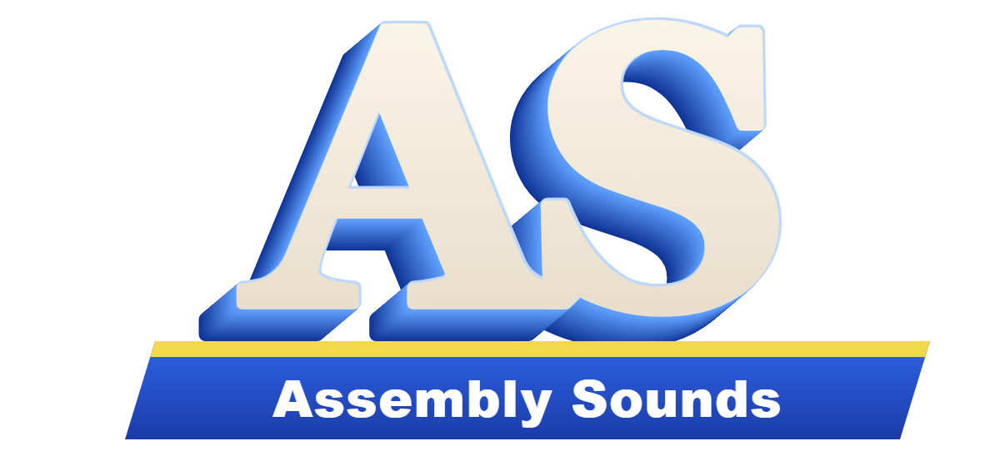

# Assembly Sounds — Binaural Beats Generator



*(formerly "Focus")* · by Vanguard Assembly

A native Windows app written in **Rust** that generates binaural, monaural, isochronic, AM, hybrid, bilateral and spatial (8D) beats in real time. It includes guided sessions inspired by the Monroe Institute's *Gateway Experience* Focus levels, and a library of **367 sessions** drawn from published research, the world's contemplative and ritual traditions, and popular frequency traditions. Every session opens with its own spoken "settle in" cue written for that practice, and every session has a step-by-step practice guide. Every session also links to the books it comes from: the **Compendium** gathers 247 source texts, from scriptures, sutras and prayers to esoteric manuals, hypnosis classics and laboratory studies, each with an introduction in plain English and the key passages in English.

## Features

- **The Compendium** (new in 1.9): a compendium of altered states, esoteric books and the books behind every meditation, with 247 texts on four shelves. 📖 **Sacred books** (130): the Bible and the Psalms, the Upanishads, the Gītā and the Yoga Sūtras, the Buddha's discourses, the Heart Sutra, the Bardo Thödol, the Daodejing, the Qur'an and the Hadith on remembrance, the Zohar and more. 🔮 **Esoteric books** (45): the Corpus Hermeticum and the Emerald Tablet, the Rosicrucian manifesto and the Chymical Wedding, alchemy, the Freemason's Monitor, the Golden Dawn, Plotinus, and Kabbalah, Tantra and Taoist inner alchemy. 🌀 **Altered states** (52): hypnosis from Mesmer's royal commission and Braid to Erickson, Monroe and the Gateway, astral projection, remote viewing, frequency lore, and the science of mystical, dream, trance and flicker states. 🔬 **The research** (57 studies and reviews, sorted by topic). Browse by shelf, tradition or kind of text (scripture, sutra, treatise, practice manual, poem, prayer, liturgy, study…), or search titles, authors and the words of the texts themselves; accents are optional and "quotes" find a phrase.
- **Source texts on every session** (new in 1.9): each session's info card has a 📜 **Source texts** section naming the books it comes from and how the session uses them, and the 📜 button in the player opens them.
- **The reader** (new in 1.9): each text has an introduction in plain English, the key passages in English (or the complete text, for short works), the original title in its own script, the author and date, the full reference for studies, further reading, and every session that uses it. Read on a paper page or a night page, with adjustable text size. Space scrolls the page while you read instead of pausing the session, and Esc closes it.
- **Home screen** (new in 1.8): after the intro, choose a path (🙏 Religious & spiritual, 🔬 Peer-reviewed, ✨ Speculative or ∞ All) or a kind of sound (binaural, isochronic, monaural, AM, hybrid, bilateral, spatial, chant & mantra, meditation music, drums & textures). Each level shows its branches as tiles, with a sound filter, a search box and the matching sessions.
- **Three-level tradition browser** (new in 1.8): Abrahamic → Christian → Christian mysticism, Catholic, Eastern Orthodox, Protestant & Quaker, Rosicrucian & alchemical, Masonic; Jewish → Kabbalah, Hasidic, Mussar; Islamic → Sufi; Bahá'í. Buddhist → Tibetan (deity & mantra, Dzogchen & Mahāmudrā, the Six Yogas, lojong, Bön), Theravada (samatha, vipassanā, loving-kindness), Zen & Chan (Rinzai, Sōtō, Chan & Seon), Pure Land, Nichiren & Shingon. Hindu & yogic → Vedanta, Tantra (Kashmir Shaivism, Śrī Vidyā), Kundalini (gentle), Mantra (Vedic, Shaiva, Vaishnava), Yoga (prāṇāyāma, rāja, haṭha & nāda, yoga nidrā). Also Jain, Sikh, Taoist, Shinto, Zoroastrian, Shamanic, Western esoteric and Modern & secular. The same tree appears as chips above the session list.
- **How to practise** (new in 1.8): every session has a beginner's guide: where and how to sit or lie, the technique in the tradition's own terms, each stage step by step with its timing and words, what you'll hear (beat type, frequencies, music and chant), what you may notice, what to do if it's difficult, safety, and how to come back afterwards.
- **Meditation music and chant** (new in 1.8): sessions that traditionally use no beats get what a practitioner would hear: tanpura, drones, harp, guqin, shakuhachi, ney and bansuri, daf and damaru, bells, gong baths, nature sound, and recorded group chant of the mantra, dhikr, psalm or prayer itself, with its own **Music & chant** level slider.
- **Sound Systems Library**: one session for every known way of delivering a rhythm to the brain: binaural, monaural, isochronic, smooth AM tones, hybrid binaural + isochronic, bilateral left↔right (EMDR-style), spatial/8D rotation, layered (Hemi-Sync-inspired) beats, descending carriers (Holosync-inspired), coloured noise and drumming. Any session can be played through any beat type.
- **Astral Projection & OBE** (23 sessions): Monroe's vibrational state and roll-out, Robert Bruce's rope technique, Muldoon's target technique, Raduga's phase technique and technique cycling, wake-back-to-bed, theta–gamma stack, spatial floating, bilateral calming, the researched induction methods (hypnotic suggestion and imagined viewpoint after Facco 2019, kinesthetic floating after Smith & Messier 2014, a 1970s laboratory-style Ganzfeld induction, SSILD), the swing and Christos techniques, Golden Dawn rising on the planes and tattva vision (with on-screen tattva cards), Tibetan phowa and dream yoga, shamanic upper- and middle-world journeys, and after-practice grounding — each labelled by evidence with the real neuroscience explained.
- **Spiritual & Mystical Experiences** (17 sessions): centering prayer, Tibetan image visualisation, free vocalisation, jhāna absorption, nondual awareness, self-inquiry, effortless mantra, a dry floatation-REST, a sober mystical-experience arc, Sufi dhikr, the Jesus Prayer, nāda yoga, vipassana body sweeping, the psychomanteum, the Taoist microcosmic orbit, hitbodedut and an inner-guide journey, each with its history and what research has (and hasn't) found.
- **World contemplative traditions** (146 sessions in 16 groups; 74 added in 1.8, including gentle Kundalini Yoga, Jain meditation, Sikh simran, Zoroastrian, Bahá'í and Shinto practice, Rosicrucian and alchemical meditation and Masonic contemplation): Christian mysticism (lectio divina, the Cloud of Unknowing, Teresa's Interior Castle, Ignatian contemplation, Taizé, Quaker silence, the rosary, the night vigil), Tibetan Buddhism and Bön (shamatha, tonglen, mantra, Dzogchen, Mahamudra, Chöd, the bardo, sleep yoga, sky gazing), Buddhist meditation (mettā, ānāpānasati, Mahasi noting, the koan Mu, shikantaza, nembutsu, daimoku, kasina, ajikan), Hindu and yogic meditation (trāṭaka, so'ham, the Vijñāna Bhairava, chakra seed sounds, japa, the Gāyatrī, kīrtan, antar mouna, the Māṇḍūkya AUM), Sufi mysticism (a seated sema, murāqaba, the laṭāʾif, Inayat Khan's breaths, the Beautiful Names), Jewish mysticism and Kabbalah (the Shema, Abulafia, the Tree of Life, ayin, merkavah, niggun), Taoist inner cultivation (zuowang, the fasting of the heart-mind, standing qigong, the six healing sounds), shamanic and ancestral rituals (lower-world journey, Goodman's ritual postures, trance dance), Western esoteric and classical practice (dream incubation, Plotinus, Hermetic contemplation, the Middle Pillar, the pentagram ritual, the bardic darkness, galdr) and trance and hypnosis techniques (autogenic training, Betty Erickson's 3-2-1, Braid's eye fixation, fractionation). Each explains its origin and era, what the tradition claims and what research has found.
- **Tradition filter:** pick a family (Abrahamic, Hindu & yogic, Buddhist, Jain, Sikh, Taoist, Shinto, Zoroastrian, Shamanic, Western esoteric, Modern & secular) to see every session from it, old and new, then narrow to a branch such as Christian, Jewish, Islamic, Tibetan, Zen, Vedanta or Hermetic, and then to a school such as Catholic, Rosicrucian, Kabbalah, Sufi, Dzogchen or Rinzai.
- **Gazing aid:** still on-screen images for kasina, trāṭaka and eye-fixation practice: nine kasina discs, a moon disc, a candle flame, a bindu and a bright point. They never flicker or move.
- **Opt-in experimental features**: ⚡ **Light journeys** (flicker-light closed-eye visuals at ~10 Hz, screen or Android flashlight, synced to the beat; includes a Sweet-Spot Sweep, Ganzflicker and Dreamachine-inspired sessions), 🌫 **Infrasound** layer (18.98 Hz "ghost frequency", 17 Hz, 7 Hz…), and 🌬 **Breathwork** (Wim Hof-style power breathing rounds and conscious connected breathing with an on-screen guide). Each requires accepting a full warning first.
- **Research and practitioner presets for light and breath**: every light session has a matching protocol in the Light journey panel, picked automatically: Bartossek 2021 (10 Hz, 3 Hz and steady-light conditions), Amaya 2023 (30% duty, rhythmic and arrhythmic blocks), the original eyes-open Ganzflicker (asks again every time, brightness capped), a 3–12 Hz frequency scan, Lucia-style flicker with steady glow, a Dreamachine, audio-visual entrainment and a phone-flashlight journey. Every breathing session has its own guide: the Kox 2014 study protocol, Stanford's cyclic hyperventilation and cyclic sighing (Balban 2023), box breathing with a CO₂ tolerance test, 4-7-8, coherent breathing, bhramari, nadi shodhana, gentle and forceful tummo, kapalabhati (Telles 2011), bhastrika (fast and Pramanik's slow pace), breath of fire, a Sudarshan Kriya-inspired sequence, rebirthing and classical 1:4:2 ratio breathing. Gentle techniques need no warning; fast breathing and long holds still do.
- **Two looks:** the **Millennium** Y2K look (new default in 1.8: chrome, frosted glass, gel buttons and holographic foil on a deep-space sky) and the **Classic XP** look (Luna title bars, task-pane session list, glossy buttons, chrome visualiser bezel). Switch with 🎨 in the header; nothing flashes in either.
- **Real-time Rust audio engine** (cpal/WASAPI). Tones are phase-continuous and glide smoothly between stages, with up to 8 layered tone pairs per session.
- **Three beat types:** binaural (headphones), monaural, and isochronic (works on speakers and above 40 Hz).
- **Natural neural narration:** spoken cues recorded with the open-source [Kokoro-82M](https://github.com/hexgrad/kokoro) model, in four voices. They're embedded in the exe, so no internet is needed.
- **Noise beds:** pink, brown, white, and ocean surf.
- **Breath pacer** (6 breaths/min), stage timeline with seek, and a stereo Lissajous visualiser.
- **Sound textures:** frame drum, singing bowls with theta-rate beating, Kirtan/lucid-dream/breath chimes, 0.8 Hz sleep pulses and rain, a wooden fish for chanting, a gourd rattle, a long gong, a soft heartbeat and kīrtan hand cymbals, plus a steady (never-flickering) Ganzfeld red-light screen.
- **Custom generator:** carrier 40–1000 Hz, beat 0.1–250 Hz, optional delta anchor layer, timer.

### Session library
| Group | Count | Notes |
|---|---|---|
| Inspired by the Gateway Experience | 5 | Focus 3, 10, 12, 15, 21 |
| Inspired by Lifeline (Focus 22–27) | 4 | Interpretations, labelled speculative |
| Research-based | 17 | Each cites its study (Lane 1998, Jirakittayakorn 2017/2018, Lutz 2004, Voss 2014, Lacaux 2021, Martorell 2019 …) |
| **Altered States** | 10 | Ranked by research volume: self-hypnosis, Ganzfeld (red light), drumming trance, lucid-dream TLR, slow-wave sleep pulses, Kirtan Kriya, singing bowls, mantra rhythm, rain soundscape, Om |
| Purpose & Tradition | 15 | OBE, remote viewing, shamanic, Om, sleep, study, energy … |
| Sound Systems Library | 11 | Every beat delivery method, side by side |
| Astral Projection & OBE | 23 | Researched inductions plus traditional and modern techniques |
| Spiritual & Mystical Experiences | 17 | Contemplative practices from Christian, Buddhist, Hindu, Sufi, Jewish and Taoist traditions |
| Christian Mysticism | 16 | Lectio divina to the night vigil, the Rosary, the Examen, Compline, the Kyrie, Eckhart |
| Tibetan Buddhism & Bön | 17 | Shamatha, tonglen, mantra, Dzogchen, the bardo, sleep yoga, Vajrasattva, Mañjuśrī, Guru Rinpoche, the White A |
| Buddhist Meditation | 22 | Theravada, Zen, Chan, Seon, Pure Land, Nichiren and Shingon |
| Hindu & Yogic Meditation | 14 | Trāṭaka, tantra, mantra, Vedanta and Patañjali |
| Kundalini Yoga (gentle) | 5 | Adi mantra, Sat Nam, Ra Ma Da Sa, gong rest, a gentle chakra breath |
| Jain Meditation | 4 | Navkār mantra, prekṣā, sāmāyika, kāyotsarga |
| Sikh Simran | 2 | Waheguru and the Mūl Mantar |
| Sufi Mysticism | 9 | Sema (seated), murāqaba, laṭāʾif, breaths, divine names, jahrī dhikr, Hū, tasbīḥ, the ney |
| Jewish Mysticism & Kabbalah | 9 | Shema, Abulafia, sefirot, ayin, merkavah, niggun, hitbonenut, Mussar, the Omer |
| Taoist Inner Cultivation | 9 | Zhuangzi, qigong, the Golden Flower, inner smile, embryonic breathing, baduanjin |
| Shamanic & Ancestral Rituals | 5 | Drum, rattle, dance, ancestors and fire |
| Zoroastrian, Bahá'í & Shinto | 4 | Ashem Vohu, Alláh-u-Abhá, harae, chinkon |
| Western Esoteric & Classical | 14 | Greek, Stoic, Hermetic, Golden Dawn, Thelemic, Celtic, Norse and the Fourth Way |
| Rosicrucian & Alchemical | 8 | Steiner, Heindel, V.I.T.R.I.O.L., the Chymical Wedding, the Great Work |
| Masonic Contemplation | 4 | The ashlar, the point within a circle, the gauge, the winding stairs |
| Trance & Hypnosis Techniques | 4 | Classic inductions and deepeners |
| Light Journeys (Flicker, opt-in) | 15 | Study protocols and practitioner styles |
| Infrasound (opt-in) | 4 | 18.98, 17, 7 and 7.83 Hz |
| Breathwork (opt-in) | 10 | Hyperventilation and breath-hold protocols |
| Breathing Techniques | 9 | Slow, gentle methods; no warning needed |
| Brainwave Library | 42 | Every common frequency from 0.5 Hz epsilon to 200 Hz "lambda" |
| Schumann Resonances | 6 | Modes 1–5 and a layered stack |
| Solfeggio | 10 | All 9 tones and a full-scale journey |
| Chakra Series | 8 | 7 chakras and a root-to-crown journey |
| Cosmic Octave | 12 | Hans Cousto planetary tones |
| Tunings | 3 | 432 / 440 / 256 Hz |

Every preset is tagged **Research**, **Gateway-inspired**, **Traditional** or **Speculative**, so you always know how much evidence is behind it.

### Also
- **Android app** (Android 8.0+): the same engine and sessions with a phone layout (Home / Sessions / Player / Info tabs), a lock-screen media player, the screen's highest refresh rate by default, and the flashlight that stops as soon as the screen locks. Built by `.github/workflows/android.yml`.
- **Remembers your settings:** narrator voice, volumes (including music & chant), noise, beat type, breath pacer, custom generator values, the look, the reader's text size and page, and the last session you played are saved in `settings.json` in the app's data folder.
- **VHS-style intro** on launch (tap or press Esc to skip; no flashing).

### About the texts
The English in the Compendium is Assembly Sounds' own plain rendering of the original, unless a public-domain translation is credited (for example the King James Bible, or William James's own words). Works still under copyright, such as modern books and studies, are summarised in our own words and never reproduced. Every text names its sources and lists published translations and studies for further reading.

## Safety & privacy
- **No network access.** The UI runs under a strict Content-Security-Policy (`default-src 'none'`), and the app makes no web requests and collects no telemetry.
- **Higher-risk methods are opt-in only:** flicker light (⚡ Light journey), infrasound (🌫) and hyperventilation breathwork (🌬) never run by default. Each has its own warning screen; every box must be ticked (health questions, safe setting, 18+, at-your-own-risk acknowledgement) before it can be used. Flicker is capped at 3–12 Hz (below the 15–25 Hz seizure-risk peak), including irregular "arrhythmic" timing, and two flashes are never closer than 1/12 s on any screen; it ramps in, goes dark between study blocks and at the end, auto-stops, and stops instantly on any tap or key or when the app is left. Infrasound is quiet (capped well below the tones) with slow fades. Breath holds are never forced.
- **The traditions library is gentle by design:** no fast breathing, no breath holds and no flicker (Kundalini sessions included: no breath of fire); whirling is done seated, trance dance asks for a clear space and no spinning, and standing qigong keeps a chair nearby. Practices that depend on fasting, long isolation, exhaustion or substances are left out.
- **No admin rights** needed. Settings live in `%LOCALAPPDATA%\FocusBinaural`.
- **Hard output limiter:** output can never exceed about −1.4 dBFS, whatever the slider settings.
- **Custom input is clamped:** carriers 20–1500 Hz, beats ≤ 250 Hz, layers ≤ 8.
- **Health warning:** not for use while driving. People with epilepsy, seizure disorders or heart conditions, or who are pregnant, should talk to a doctor first. This is not medical treatment.

## Building
```powershell
# MSVC toolchain: produces one self-contained exe
cargo build --release --target x86_64-pc-windows-msvc
```
With the MinGW (`windows-gnu`) toolchain, the exe also needs `WebView2Loader.dll` (Microsoft-signed) next to it.

### Regenerating voice cues (optional, build-time only)
```powershell
FocusBinaural.exe --dump-cues tools/cues.json
python tools/gen_voices.py kokoro-v1.0.onnx voices-v1.0.bin   # needs kokoro-onnx, soundfile, ffmpeg
```
Or render them in the cloud: commit `tools/cues.json`, then run the **Narration** workflow (`gh workflow run voices.yml`), which renders each voice in its own job and commits the new clips.

## Evidence summary
A 2019 meta-analysis (Garcia-Argibay et al., *Psychological Research*) found small-to-moderate effects of binaural beats on anxiety, memory, attention and pain perception. EEG studies (e.g. Orozco Perez et al., 2020, *eNeuro*) found little evidence that brainwaves actually lock onto the beat. The Gateway presets are interpretations: Monroe's Hemi-Sync frequency mixes are proprietary.
